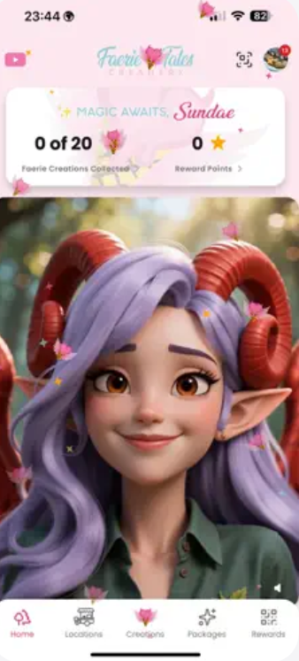

<!-- ================= ANIMATED HEADER ================= -->

  

<!-- ================= INTRO ================= -->

<h1 align="center">Hey there! 👋 I'm Austin</h1>

<h3 align="center">
  📱 iOS & Android Developer | React Native & Flutter Engineer
</h3>

  

  

---

<!-- ================= ABOUT ME ================= -->

## 🧑‍💻 About Me

I'm a passionate **Mobile Application Developer** focused on building modern, scalable, and high-performance applications for iOS and Android.

I enjoy taking ideas from concept to production, creating smooth user experiences, and writing clean, maintainable code.

- 📱 Building cross-platform apps with React Native and Flutter.
- 🍎 Interested in native iOS development.
- 🤖 Passionate about Android application development.
- ⚡ Working with TypeScript, Dart, Swift, and Kotlin.
- 🎨 Focused on responsive UI, animations, and user experience.
- 🚀 Always exploring new technologies and improving my skills.

---

<!-- ================= TECH STACK ================= -->

## ⚡ Technologies & Tools

### Mobile Development

  

### Programming Languages

  

### Tools & Platforms

  

---

<!-- ================= FEATURED PROJECTS ================= -->

## 🚀 Featured Projects

  <i>A selection of projects I've worked on. Explore the screenshots and source code below.</i>

<!-- PROJECT 1 -->

### 📸 Project One: [Faerie Tales Creamery](https://apps.apple.com/us/app/faerie-tales-creamery/id6753595062)

  

**Description:** A beautifully designed mobile application for Faerie Tales Creamery, focused on delivering a delightful and seamless user experience. The app combines an engaging interface, intuitive navigation, and modern mobile development to bring the creamery's brand experience to life.

**Built with:** React Native · TypeScript · Firebase

**Highlights:**
- Modern and responsive UI.
- Smooth navigation and user experience.
- API integration and data management.

  

---

<!-- PROJECT 2 -->

<!-- ================= INTRO ================= ### 📱 Project Two — [Your Project Name](PROJECT_2_LINK)

  

**Description:** Add a short introduction explaining what this application does.

**Built with:** Flutter · Dart · REST API

**Highlights:**
- Clean and reusable architecture.
- Cross-platform application development.
- Optimized performance and UI.

  

---

<!-- PROJECT 3 -->

<!--### 🍎 Project Three — [Your Project Name](PROJECT_3_LINK)

  

**Description:** Describe your iOS or Android application here.

**Built with:** Swift · SwiftUI · UIKit

**Highlights:**
- Native mobile development.
- Smooth and intuitive interfaces.
- Focus on performance and usability.
-->

  

---
-->

<!-- ================= GITHUB STATS ================= -->

## 📊 GitHub Statistics

  
  

  

---

<!-- ================= CONTRIBUTION GRAPH ================= -->

## 📈 Contribution Activity

  

---

<!-- ================= INTERESTS ================= -->

## 🎯 What I'm Currently Focused On

- 🚀 Building high-quality mobile applications.
- 📲 Exploring advanced React Native and Flutter capabilities.
- ⚙️ Improving application architecture and performance.
- 🎨 Creating polished interfaces and interactive experiences.
- 🧠 Learning new tools and modern development practices.

---

<!-- ================= FOOTER ================= -->

<h3 align="center">💬 Let's Build Something Great!</h3>

  Thanks for visiting my GitHub profile.
   
  Feel free to explore my repositories and projects!

  

  

